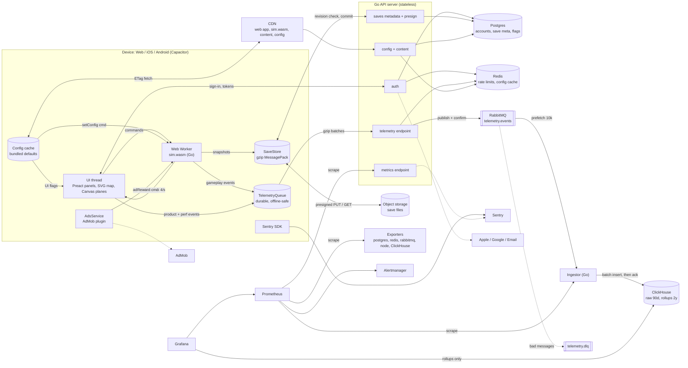
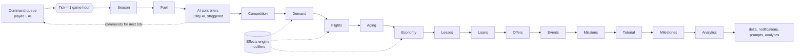
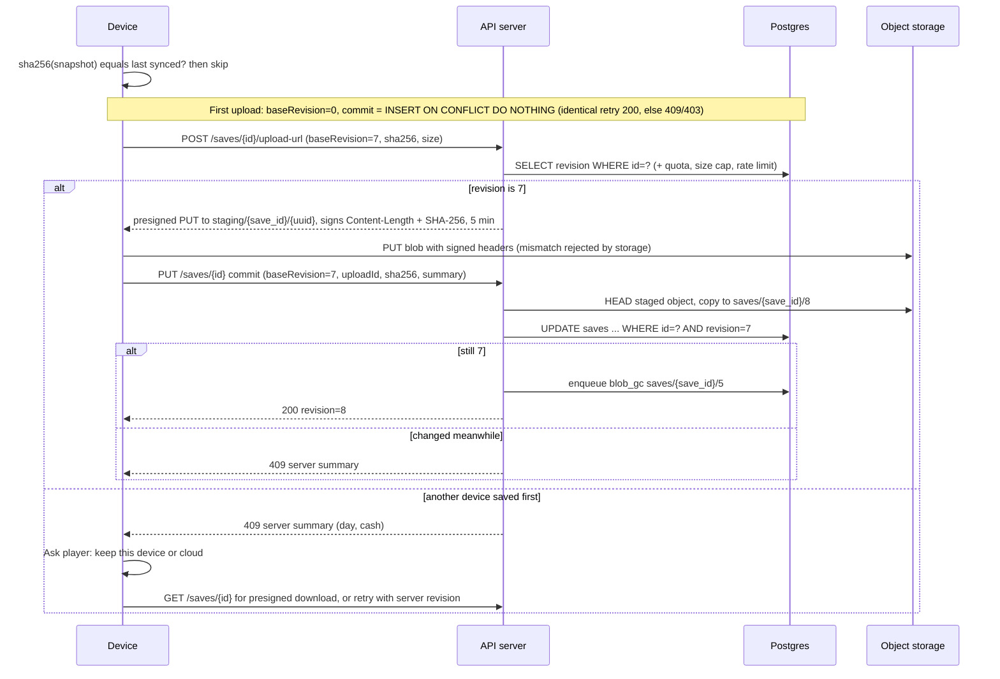
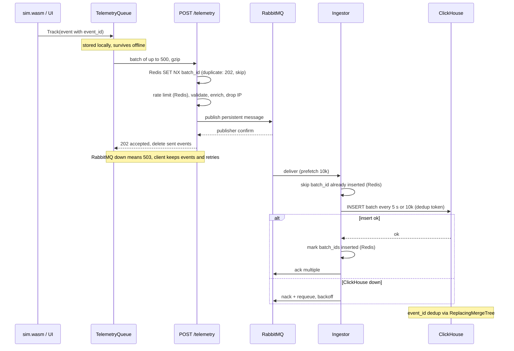
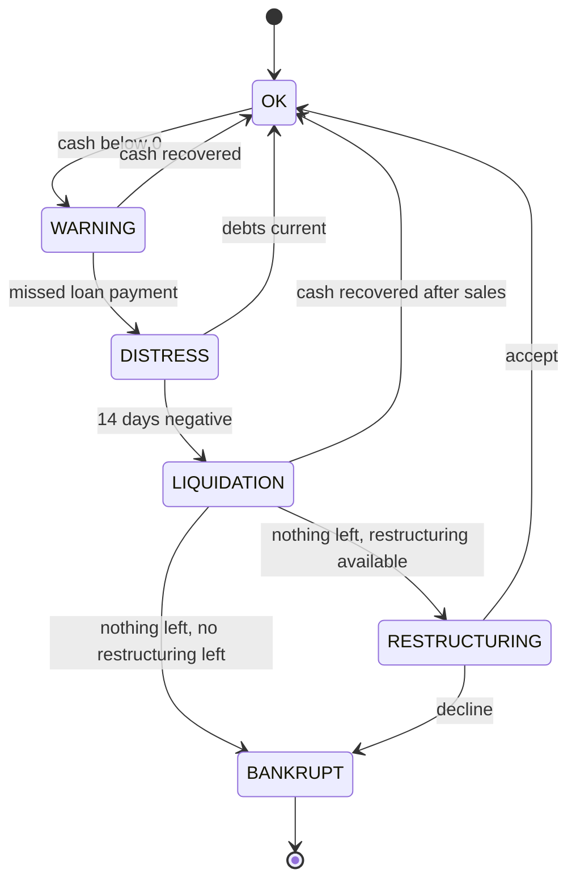
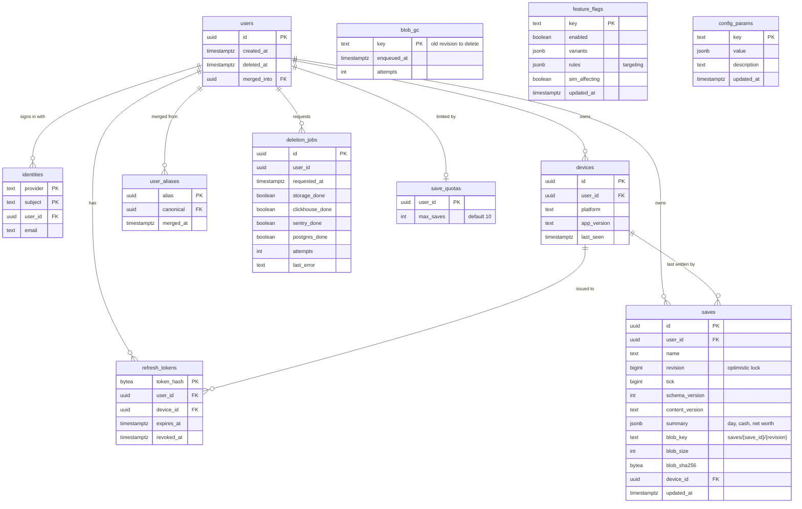
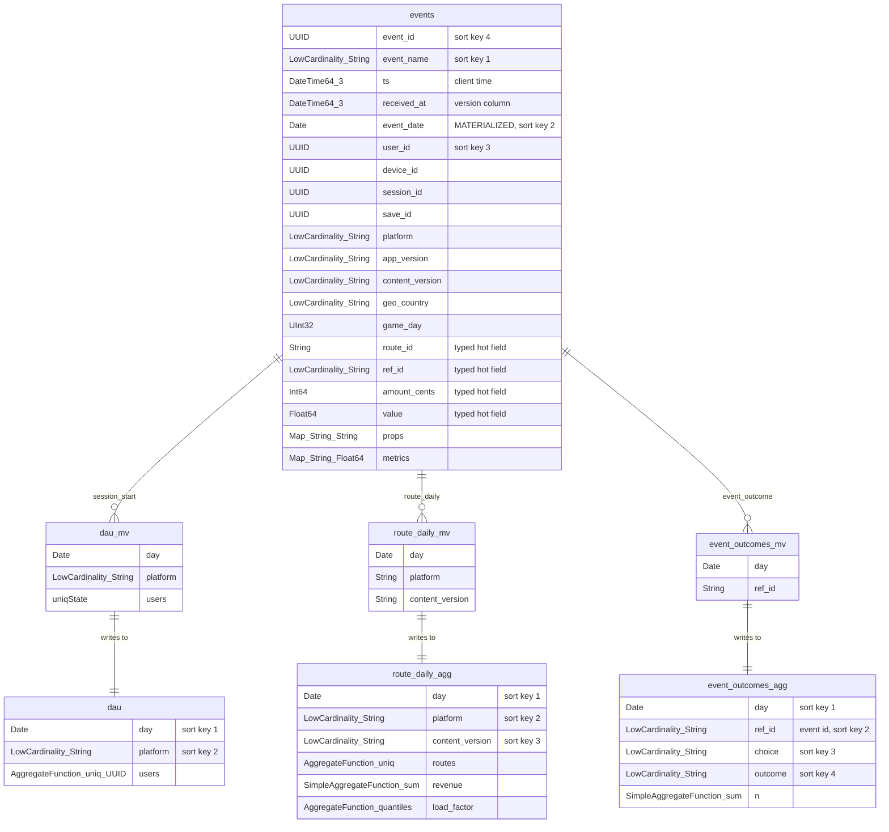
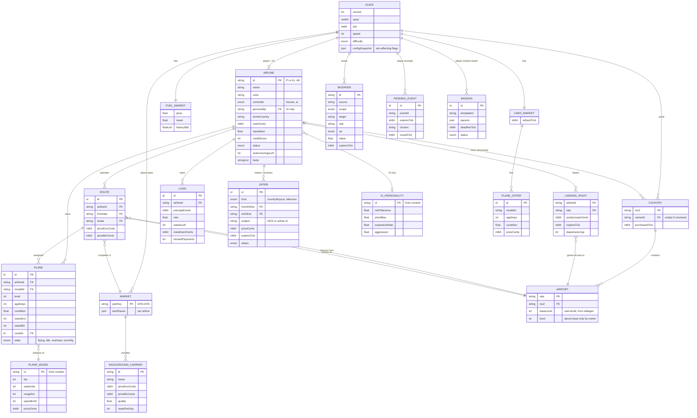
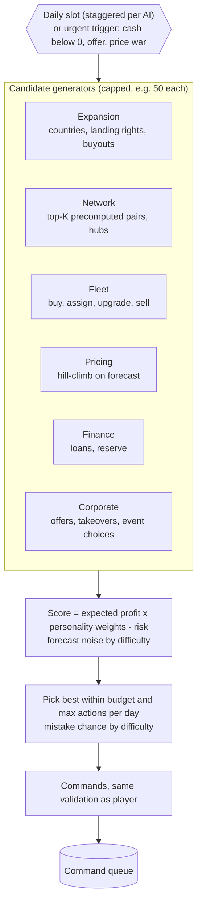

# Jetstream Tycoon — Diagrams

## 1. System architecture
Every device runs the game simulation itself. The server only handles accounts, save sync, analytics and config.

## 2. Simulation tick pipeline
Commands from the player and the AI airlines are applied at the start of a tick, and both go through the same validation. Then the systems run in a fixed order. Each system has its own RNG stream, and each AI airline has its own too.

## 3. Cloud save sync
Revisions use optimistic locking. Save files go straight to object storage through presigned URLs, which sign the size and checksum, into a staging prefix that expires after 24 h. The server keeps the last 3 committed revisions. Nothing is uploaded if the save hasn't changed.

## 4. Telemetry pipeline

## 5. Airline financial status

## 6. Postgres schema

## 7. ClickHouse schema
`events` uses `ReplacingMergeTree(received_at)`, `PARTITION BY toYYYYMM(event_date)`, `ORDER BY (event_name, event_date, user_id, event_id)` and `TTL 90 days` with codecs (Delta/ZSTD, T64, Gorilla). The rollup tables are kept 2 years, and Grafana reads only those.

## 8. Save state model
The game state is stored as one gzip-compressed MessagePack snapshot in object storage. The Postgres row in `saves` points to it. Plane models come from content files, not from the save.

## 9. AI airline decision loop

